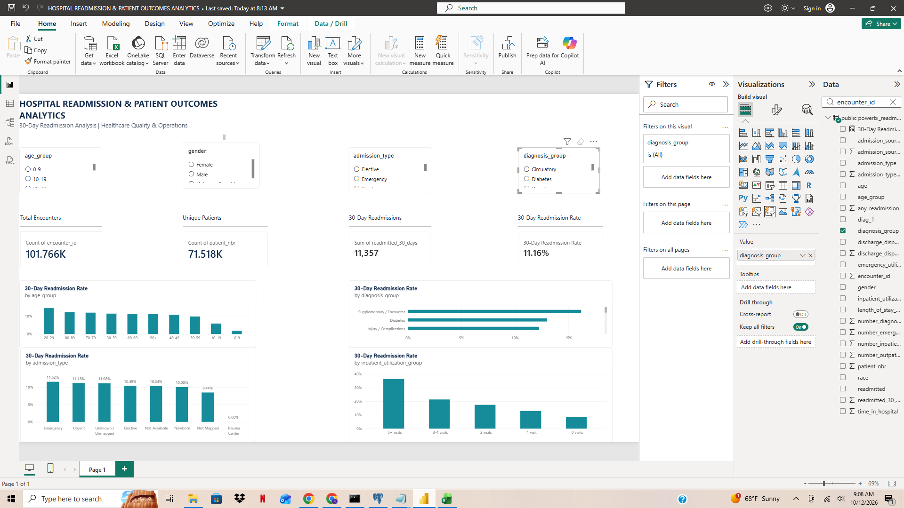

# Healthcare Readmission & Patient Outcomes Analytics

## Project Overview

This project analyzes hospital encounters involving patients with diabetes to explore 30-day readmissions and identify patterns across age groups, primary diagnosis categories, admission types, and prior inpatient utilization.

The goal is to demonstrate practical data analytics skills by cleaning healthcare data, querying a PostgreSQL database, developing key performance indicators (KPIs), and presenting findings through an interactive Power BI dashboard.

## Dashboard



*The dashboard includes interactive filters and KPI cards for exploring readmission patterns.*

## Business Questions

* What percentage of hospital encounters resulted in a readmission within 30 days?
* How does the 30-day readmission rate vary across age groups?
* Which diagnosis categories have higher readmission rates or encounter volumes?
* How do readmission rates vary by admission type?
* Is prior inpatient utilization associated with higher readmission rates?

## Key Performance Indicators

| Metric                  |  Result |
| ----------------------- | ------: |
| Total encounters        | 101,766 |
| Unique patients         |  71,518 |
| 30-day readmissions     |  11,357 |
| 30-day readmission rate |  11.16% |

**Definition:** In this project, a 30-day readmission is an encounter with `readmitted = '<30'`. The rate uses total encounters as its denominator.

## Key Findings

* **Overall readmission rate:** 11.16% of encounters were followed by a recorded readmission within 30 days.
* **Age-group variation:** The 20–29 age group had the highest observed rate among the age groups analyzed, at 14.24%. This group contained 1,657 encounters, so its rate should be interpreted alongside the sample size.
* **Diagnosis patterns:** Circulatory diagnoses accounted for the largest encounter volume in the diagnosis-group analysis, with 30,336 encounters and 3,474 30-day readmissions.
* **Diabetes diagnosis group:** This group had a 12.98% 30-day readmission rate, above the overall project rate.
* **Prior inpatient utilization:** The observed rate increased from 8.44% among encounters with zero prior inpatient visits to 36.41% among encounters in the five-or-more-visit group.

These are descriptive findings from the dataset. They show associations and patterns, not proof that any factor causes readmission.

## Tools & Technologies

* **SQL / PostgreSQL:** Data querying, aggregation, and readmission analysis
* **Python / pandas:** Data cleaning, missing-value standardization, age grouping, and mapping preparation
* **Power BI:** Interactive dashboard, KPI cards, charts, and slicers
* **Git / GitHub:** Version control and project documentation

## Project Structure

```text
healthcare-readmission-analytics-main/
├── data/
│   ├── raw/                 # Local source datasets; excluded from Git
│   └── cleaned/              # Local cleaned datasets; excluded from Git
├── docs/
│   └── data-profile.md       # Dataset profiling and quality notes
├── powerbi/                  # Power BI project files, as applicable
├── python/
│   ├── clean_dataset.py
│   ├── create_mappings.py
│   └── load_to_postgres.py
├── screenshots/
│   └── healthcare_readmission_dashboard.png
├── sql/
│   ├── 01_readmission_kpis.sql
│   ├── 02_readmission_by_age.sql
│   ├── 03_readmission_by_gender.sql
│   ├── 04_readmission_by_diagnosis.sql
│   ├── 05_diagnosis_grouping.sql
│   ├── 06_readmission_by_length_of_stay.sql
│   ├── 07_readmission_by_admission_type.sql
│   └── 08_readmission_by_utilization.sql
├── .gitignore
├── LICENSE
└── README.md
```

*Adjust the structure above if your actual repository differs.*

## Data Source

**Dataset:** Diabetes 130-US Hospitals for Years 1999–2008
**Source:** UCI Machine Learning Repository

The dataset contains hospital encounter records involving patients with diabetes. It includes encounter details, diagnosis codes, admission information, medications, and readmission status.

## Data Preparation

The Python cleaning workflow standardizes missing values, groups ages, creates readmission indicators, and prepares admission-related mapping tables. The cleaned dataset is then loaded into PostgreSQL for analysis.

## Limitations

* The dataset covers historical encounters from 1999–2008 and may not represent current hospital practices.
* Multiple encounters can belong to the same patient, so encounter counts and patient counts are different.
* Missing and unmapped values may affect some categories.
* The analysis is observational and does not establish causation.
* Findings should not be interpreted as clinical recommendations.

## Future Improvements

* Add automated data-quality checks and reproducible analysis steps.
* Refine unclassified diagnosis categories.
* Add additional dashboard views and deeper utilization analysis.
* Document the SQL environment setup and database schema.

## Author

**Data Analytics Portfolio Project**

This project demonstrates an end-to-end analytics workflow, from data preparation and SQL analysis to interactive reporting and communication of findings.
